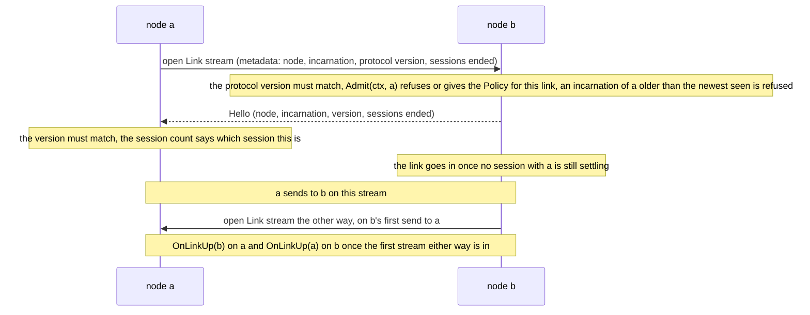
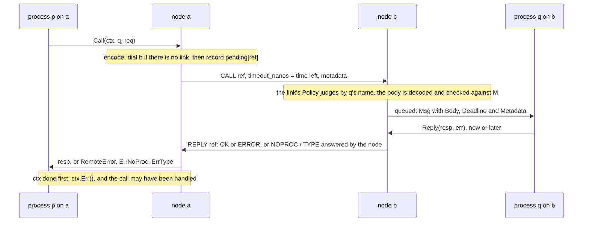
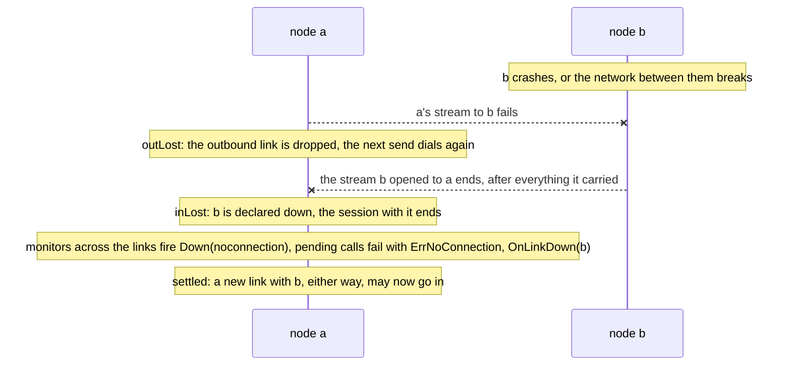
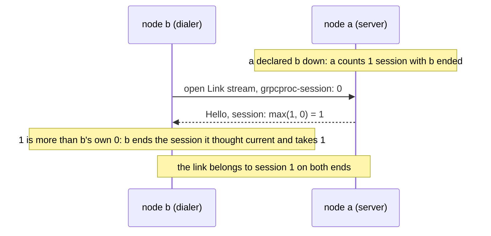
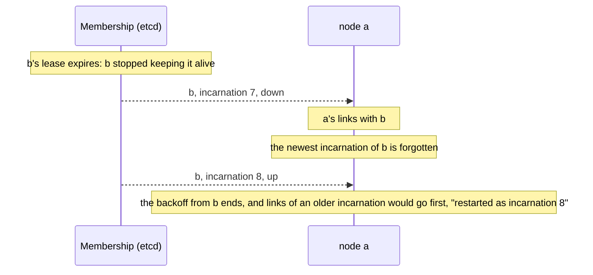
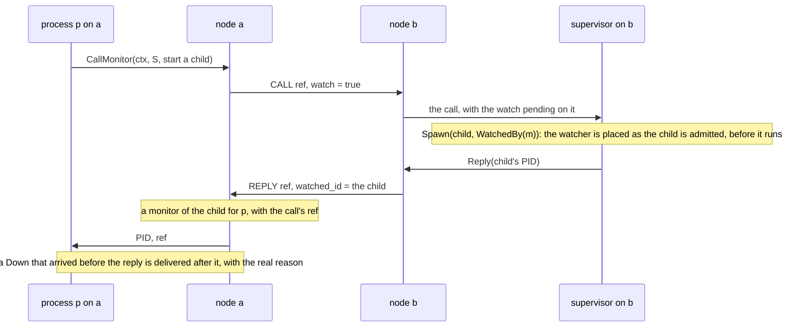
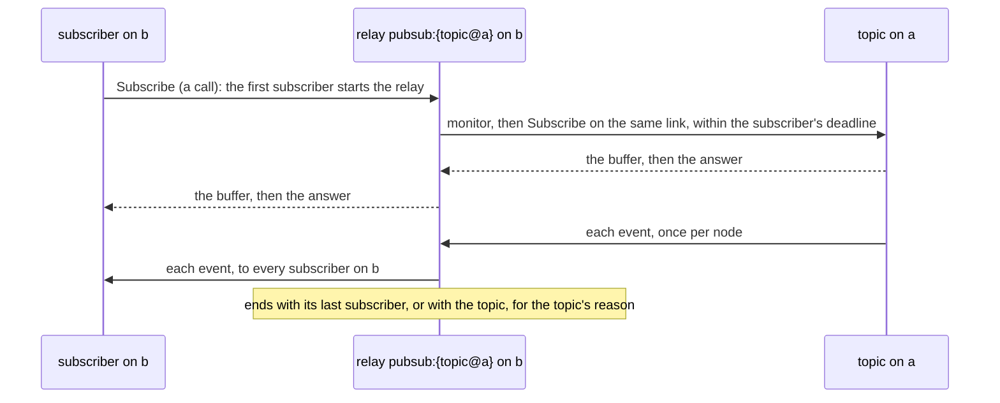
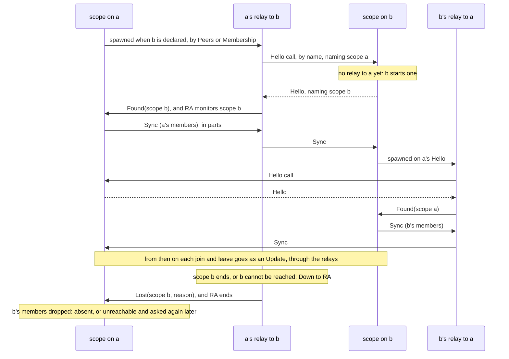
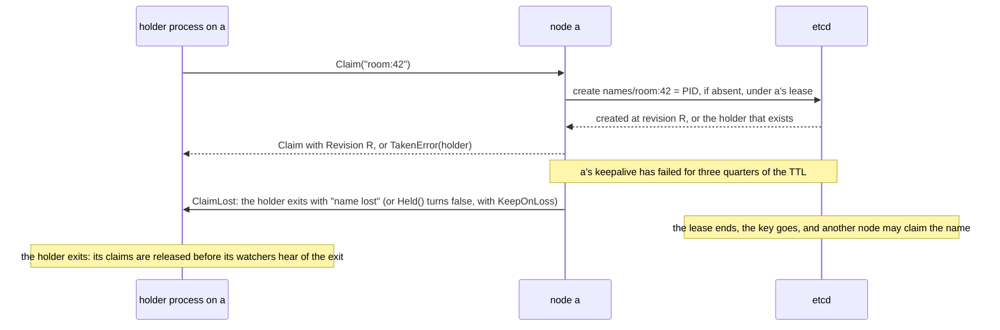
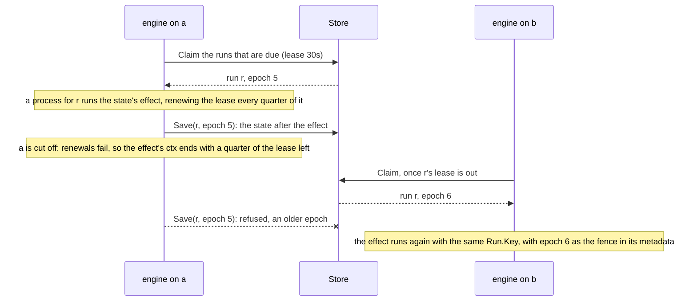

# grpcproc — design

`grpcproc` gives goroutines Erlang-style network transparency over gRPC. A
node is one gRPC service on a `*grpc.Server` the application owns, beside
its other services. A process is a goroutine with a typed mailbox, addressed
by a PID or a name, and `Send`, `Call`, `Monitor`, `Link` and `Exit` work
the same whether the target is in this binary or on another node.

This is the model: how each part works, why it was chosen over what
ergo.services, Proto.Actor, GoAkt, Hollywood, Erlang/OTP, Akka and Orleans
do, what was rejected, and what is still open. The package READMEs and the
site say how to use it; `CLAUDE.md` has the working detail for a change.

## Contents

- [Principles](#principles)
- [The shape at a glance](#the-shape-at-a-glance)
- [Package layout](#package-layout)
- [Core](#core)
  - [Identity](#identity)
  - [Typed processes](#typed-processes)
  - [Wire protocol](#wire-protocol): [streams](#one-stream-per-direction),
    [a call](#a-call), [a peer going down](#a-peer-going-down),
    [sessions](#sessions-are-counted-on-both-ends),
    [backing off](#a-failed-dial-backs-off),
    [queues](#queues-are-per-peer-and-may-be-bounded),
    [stopping](#a-graceful-stop-flushes-first)
  - [Links](#links)
  - [Admission](#admission)
  - [Discovery interfaces](#discovery-interfaces)
  - [grpcproctest](#grpcproctest)
- [Observability](#observability)
  - [Process snapshot](#process-snapshot)
  - [Self-inspection](#self-inspection)
  - [Hooks: the single tap](#hooks-the-single-tap)
  - [Events](#events)
  - [Inspector service](#inspector-service-grpcprocinspect)
  - [Profiles](#profiles)
- [Helpers (`grpcproc/actor`)](#helpers-grpcprocactor)
- [Remote spawn](#remote-spawn)
- [Pub/sub (`grpcproc/pubsub`)](#pubsub-grpcprocpubsub)
- [Process groups (`grpcproc/groups`)](#process-groups-grpcprocgroups)
- [Cron and leader election](#cron-and-leader-election)
- [Global names](#global-names)
- [Sagas (`grpcproc/saga`)](#sagas-grpcprocsaga)
- [What was rejected, and why](#what-was-rejected-and-why)
- [Open work](#open-work)

## Principles

It is a library, not a framework, in the sense that `fsm` and `di` are:

| Principle | What it means |
|---|---|
| **The caller owns the infrastructure** | `grpcproc` opens no listener, reads no environment, installs no global and starts no goroutine outside `Start` and `Stop`. The application brings its `*grpc.Server`, credentials, discovery, `slog` and lifecycle; `grpcproc` registers one service on that server. |
| **Errors at construction, none in the hot path** | Bad config fails in `NewNode`. A local `Send` allocates nothing and never panics. |
| **Introspection is a first-class API** | Snapshots come in stable order, so a test asserts on them and a tool renders them. |
| **The core depends on gRPC, protobuf and `fsm` only** | Everything that would pull in another dependency (etcd, OpenTelemetry, PostgreSQL) is a nested module behind an interface the core defines. |

## The shape at a glance

```go
node, err := grpcproc.NewNode(grpcproc.Config{
    Name:        "orders-1",
    Advertise:   "10.0.0.5:9000",           // where *your* gRPC server listens
    Resolver:    grpcprocetcd.New(cli, "/grpcproc"), // required; grpcproc.StaticResolver for a fixed map
    DialOptions: []grpc.DialOption{grpc.WithTransportCredentials(creds)},
    Admit:       grpcproc.AdmitTLS(nil),   // required: a peer's certificate must name its node
    Logger:      slog.Default(),
    Hooks:       otelHooks, // grpcprocotel.New(): optional, see Observability
})
node.Register(grpcServer) // mounts grpcproc.v1.Node
node.Start(ctx)
defer node.Stop(ctx)

// A typed process: it receives *orderspb.OrderMsg (a oneof) and nothing else.
addr, _ := node.Spawn[*orderspb.OrderMsg](func(p *grpcproc.Process[*orderspb.OrderMsg]) error {
    for {
        m, err := p.Receive()
        if err != nil { return err }              // Exit, node stop, …
        if m.Down != nil { /* a monitored process is gone */ continue }
        switch m.Body.Kind.(type) {
        case *orderspb.OrderMsg_Reserve: m.Reply(&orderspb.Reserved{}, nil)
        }
    }
}, grpcproc.WithName("reservations"), grpcproc.WithLabel("order"))

// From any node: the node itself, or a process (inside its function), sends.
addr.Send(ctx, node, &orderspb.OrderMsg{Kind: &orderspb.OrderMsg_Reserve{}}) // compile-time typed
resp, err := addr.Call[*orderspb.Reserved](ctx, node, &orderspb.OrderMsg{})  // reply typed by R

// Inside a process: watch something on another node.
ref := p.Monitor(grpcproc.Name{Node: "billing-2", Name: "ledger"})
```

## Package layout

| Path | What it holds |
|---|---|
| `grpcproc` | the core: `Node`, `Process`, `PID`, `Send`/`Call`/`Monitor`/`Link`/`Exit`, node links, the inspection API |
| `proto/grpcproc/v1` | the wire protocol; `inspect/v1`, `actor/v1`, `pubsub/v1` beside it |
| `grpcproctest` | in-memory clusters over bufconn: `Cluster`, `Partition`, `Kill` |
| `inspect` | the `grpcproc.inspect.v1.Inspector` gRPC service, optional to register; its Go client is `tools/client` |
| `actor` | the handler loop, supervisors, workers |
| `pubsub` | topics with a replay buffer, relayed once per node |
| `groups` | process groups: named sets of processes on any node, listed and watched |
| `cron` | jobs on crontab schedules, every run a process |
| `leader` | leader election, and a singleton that runs on the leader with its state |
| `saga` | durable sagas: an fsm machine and its data per run, behind a `Store` |
| `etcd` (nested module) | `Resolver`, `Registrar`, `Membership` and `Names` on etcd leases |
| `saga/postgres` (nested module) | `saga.Store` in PostgreSQL; `saga/postgres/integration` holds its tests, with the drivers it does not require |
| `otel` (nested module) | `Hooks`: OpenTelemetry metrics and trace propagation |
| `tools` (nested module) | `grpcprocctl` over the Inspector: CLI, Graphviz, MCP server, web UI |
| `examples`, `benchmarks` (nested modules) | runnable examples the site builds on; grpcproc against GoAkt, Hollywood, Proto.Actor and Ergo |
| `site/` | the documentation site |

`grpcproctest` is part of the core module on purpose: the best argument for
network transparency is that a three-node scenario, a node dying included,
runs in a plain `go test` with no sockets and no etcd.

## Core

### Identity

```go
type PID  struct { Node string; Incarnation uint64; ID uint64 }
type Name struct { Node, Name string }
type Ref  struct { Node string; ID uint64 }   // monitor reference
```

**An incarnation is one start of a node.** `Config.Incarnation` grows with
each start, by default the start time in nanoseconds. A PID from before a
restart names a different process: it gets `Down{noproc}`, never a message
delivered to a stranger. Erlang has creation numbers for the same reason;
Proto.Actor and GoAkt do not, and both have issues about stale references
after restarts.

**Incarnations fence links.** Two instances can hold one node name at
once: one replaced but still running after a partition heals, or two
deploys given one name. If a link from either replaced the other's, each
would take its peers down for the other for as long as both ran. So a node
remembers, per peer name, the newest incarnation it has seen, over a link
or from `Membership`, and refuses an older one: an inbound link before its
`Hello`, and a dial that reaches one through a stale address. A newer
incarnation's links replace the older one's, which go first with
"restarted as incarnation N". The newest is forgotten when `Membership`
reports it gone, or on `Disconnect`. The rule needs incarnations that grow with each start, which
the start time does as long as clocks agree to within the time between two
starts. It fences grpcproc traffic only: an old instance can still write
to a database, which needs fencing of its own.

**Names are per node.** A name of the whole installation is a global name
(see [Global names](#global-names)): claimed by a process and kept in a
store, deliberately apart from local registration, as Erlang's `global` is.

### Typed processes

The type of a process's messages lives on its **address**, so it survives
the network boundary and every send is checked by the compiler:

```go
type Addr[M proto.Message] struct { /* PID or Name, plus the phantom type M */ }

func (n *Node) Spawn[M proto.Message](fn func(*Process[M]) error, opts ...SpawnOption) (Addr[M], error)
func Named[M proto.Message](node, name string) Addr[M]   // remote by name; checked on delivery
func AddrOf[M proto.Message](t Target) Addr[M]           // a PID or a Name, typed
func (a Addr[M]) PID() PID
func (a Addr[M]) Node() string
func (a Addr[M]) Name() string
func (a Addr[M]) Call[R proto.Message](ctx, from Caller, req M) (R, error) // from: a *Node or a *Process
func (a Addr[M]) CallMonitor[R proto.Message](ctx, from Caller, req M) (R, Ref, error) // from a process; see Remote spawn
func (a Addr[M]) CallLink[R proto.Message](ctx, from Caller, req M) (R, error)
func (a Addr[M]) Send(ctx, from Caller, m M) error

func (p *Process[M]) PID() PID
func (p *Process[M]) Addr() Addr[M]
func (p *Process[M]) Node() *Node
func (p *Process[M]) Receive() (Msg[M], error)
func (p *Process[M]) ReceiveTimeout(d time.Duration) (Msg[M], error)
func (p *Process[M]) CallTo[R proto.Message](ctx, to Target, req proto.Message) (R, error)
func (p *Process[M]) SendTo(to Target, m proto.Message) error
func (p *Process[M]) SendAfter[N proto.Message](d time.Duration, to Addr[N], m N) *Timer
// Node has SendTo / CallTo / Exit too, with the node as sender; its SendTo
// and Exit take a ctx, for the dial (SendTo also carries its metadata).
func (p *Process[M]) Monitor(to Target) Ref
func (p *Process[M]) Demonitor(ref Ref)
func (p *Process[M]) Link(to Target)           // one way: to's exit ends p
func (p *Process[M]) Unlink(to Target)
func (p *Process[M]) SetTrapExit(trap bool)    // links' exits arrive as messages
func (p *Process[M]) TrapExit() bool
func (p *Process[M]) Parent() PID              // the spawning process, if any
func (p *Process[M]) Exit(to Target, reason string) error
func (p *Process[M]) Log() *slog.Logger        // pid and label attrs attached
func (p *Process[M]) Context() context.Context // cancelled on Exit, a link's exit, node stop

type Msg[M proto.Message] struct {
    From     PID
    Body     M        // zero when Down or Exited is set
    Down     *Down    // set when a monitored process is gone
    Exited   *Exited  // set when a linked process is gone, if p traps exits
    Metadata Metadata
}
func (m Msg[M]) IsCall() bool
func (m Msg[M]) Reply(resp proto.Message, err error) error // may be deferred, from any goroutine
func (m Msg[M]) Deadline() (time.Time, bool)   // when a call's caller stops waiting
func (m Msg[M]) Context(parent context.Context) (context.Context, context.CancelFunc) // metadata, ending then
func (m Msg[M]) Watch(pid PID) error            // a CallMonitor's watch, on a process that runs
```

`M` is whichever of these fits:

| `M` | Send site | Use |
|---|---|---|
| a generated oneof wrapper, `*orderspb.OrderMsg` | `a.Send(ctx, p, &orderspb.OrderMsg{Kind: …})` | one contract per process, visible in the `.proto` |
| your own marker interface, `OrderMsg interface{ proto.Message; orderMsg() }` | `a.Send(ctx, p, &orderspb.Reserve{})` | several generated types, no wrapper, one extra method each |
| `proto.Message` | `p.SendTo(a, anything)` | the untyped process |

**The address sends, and takes the sender.** A typed send or call goes
through the address, whose `M` fixes the type; the Node and the Process
have only the untyped `SendTo` and `CallTo`, so there is one way to write
every send. `Addr.Call` and `Addr.Send` take the sender as a `Caller`, the
`*Node` or a `*Process`: an interface cannot declare a generic method, so
the address calls, and who sends matters, since a process's call carries
the metadata of the message it is handling and shows the process waiting
on a reply. A contract package writes its protocol as methods on an address
type of its own, so each operation's reply type and request wrapper are
named once:

```go
type StockAddr struct{ grpcproc.Addr[*Command] }

func (s StockAddr) Reserve(ctx context.Context, from grpcproc.Caller, r *Reserve) (*Reserved, error) {
    return s.Call[*Reserved](ctx, from, &Command{Op: &Command_Reserve{Reserve: r}})
}

reserved, err := stock.Reserve(ctx, p, &Reserve{Sku: "apple", Qty: 2}) // p, or a node
```

**Types do not cross the wire.** The untyped process is the typed one
instantiated with the interface, so there is one implementation. A remote
sender can address `Named[*A]` at a process that is `Process[*B]`; the
receiving node checks `decoded.(M)` on delivery, and a mismatch is a dead
letter with reason `type`, counted and passed to `Hooks.OnDeadLetter`,
never a panic inside the process. The assertion runs for local sends too:
the address `Spawn` returned always passes, and a `Named` or `AddrOf` of
the wrong type, or an untyped `SendTo`, is a dead letter on the same node.

**`Down` arrives through the same `Receive`**, in order with messages, so
"a process's last message is seen before its `Down`" holds for typed
processes too.

**Mailboxes are unbounded by default**, the Erlang choice: delivery that
waited for a mailbox would stall every process behind it on the shared
stream. A process that cannot shed load itself is spawned
`WithMailboxLimit(n)`: while its mailbox holds n items, a message to it is
a dead letter with reason `mailbox full` and a call fails with
`ErrMailboxFull`, never handled, so it is safe to make again. `Down`s and
`Exited`s always get in, or a monitor would not fire. A refused send is not
an error, since `Send`'s error only ever means the message could not leave
its node; a sender that must know calls. On the wire a refused call is
`STATUS_NOPROC` with reason `mailbox full`, which no handler can answer, so
an older node reads `ErrNoProc`, never handled either; a handler that
passes a downstream `ErrMailboxFull` on answers a `RemoteError`, matched by
its text, which may have been handled. Past that,
backpressure is the application's, with the mailbox depth, its limit and
each link's queue visible (see [Observability](#observability)).

**Exit reasons:** `normal`, `noproc`, `noconnection`, `shutdown`, `killed`,
a panic (`panic: …`, with the stack logged), `goexit` for a function that
called `runtime.Goexit` (`t.FailNow`, say), or the error string the
function returned.

### Contracts as services

A process's protocol is a proto `service` marked with an option, and the
Go of it is generated, as gRPC's stubs are:

```proto
import "google/protobuf/empty.proto";
import "grpcproc/v1/options.proto";

service Runner {
  option (grpcproc.v1.process) = {name: "tools"};
  rpc Run(tools.v1.Run) returns (Ran);                 // a call, answered with Ran
  rpc Note(Note) returns (google.protobuf.Empty) {     // a send: nothing answers it
    option (grpcproc.v1.send) = true;
  }
}
```

`protoc-gen-grpcproc`, a command of the core module (`cmd/protoc-gen-grpcproc`,
over `internal/protocgen`), writes `tools_grpcproc.pb.go` beside
`protoc-gen-go`'s file: `RunnerAddr`, an address with a method per rpc that
names the reply once (`Run(ctx, from, *Run) (*Ran, error)`, `Note(ctx, from,
*Note) error`), `RunnerAddrOf(Target)` and, for a service with a name,
`RunnerProcess` and `RunnerAt(node)`; and the process's side,
`RunnerHandler`, an interface with a method per rpc, with
`HandleRunnerCall` and `HandleRunnerMessage` dispatching a message to it
from an actor's `HandleCall` and `HandleMessage`. A call of a type the
service has no rpc for is answered `ErrType`; a send of one is logged and
dropped, as `actor.CallsOnly` drops a message. A service without the
option is left alone, so a gRPC service and a process can share a file.

Why a service and not a message with a `oneof` of operations, which is how
the guide and yarco began: a service already states each request with its
reply, which is exactly what a hand-written address repeats and gets out of
step with; `buf lint` and every proto tool understand it; and it has a
server side, so a forgotten rpc is a compile error in the handler rather
than a case missing from a switch. The cost is that the process's mailbox
is `proto.Message`: each request travels as its own message, and the type
check moves from the node's delivery, which checked the mailbox's one type,
to the generated dispatch, which answers `ErrType` for a stranger. What a
caller sees is the same. What the service cannot say, the package writes by
hand around the generated type: the guide's conversation is addressed by
node and id, and opened before it is called.

The plugin is installed as a tool dependency of the application, pinned in
its `go.mod` to the core's version, since generated code targets the core's
API; `buf generate` runs it from there, so the build is the same on every
machine:

```sh
go get -tool github.com/floatdrop/grpcproc/cmd/protoc-gen-grpcproc@v0.15.0
```

```yaml
# buf.gen.yaml
plugins:
  - local: protoc-gen-go
    out: .
    opt: module=example.com/app
  - local: ["go", "tool", "protoc-gen-grpcproc"]
    out: .
    opt: module=example.com/app
```

The options come from `proto/grpcproc/v1/options.proto`, which an
application's protos import. buf resolves imports from the Buf Schema
Registry, where this repository does not publish yet, so an application
copies the file into its proto tree: one file, importing only
`descriptor.proto`. The extension numbers are not registered in protobuf's
global extension registry. The plugin itself is
tested without protoc: `internal/protocgen/testdata/image.txtpb` is the
test protos' descriptors as `buf build` wrote them, comments included, and
the test runs the generator over them and compares with the checked-in
output, which `buf generate` keeps current.

### Wire protocol

One gRPC service, one method:

```proto
service Node { rpc Link(stream Frame) returns (stream Frame); }

message Frame { repeated Envelope envelopes = 1; }   // everything queued since the last write

message Envelope {                                   // one flat message, decoded cheaply
  Kind kind = 1;                                     // send, call, reply, monitor, demonitor, down, exit, hello
  uint64 from_incarnation = 2; uint64 from_id = 3;   // on the node that opened the link
  uint64 to_incarnation = 4;   uint64 to_id = 5;     // on the node that accepted it
  string to_name = 6;
  uint64 ref = 7; Status status = 8; string reason = 9;
  string body_type = 10; bytes body = 11;            // the message's full name and encoding
  Hello hello = 12;
  int64 timeout_nanos = 13;                          // a call's time left, not its deadline
  map<string,string> metadata = 15;                  // trace context, tenant …
  bool watch = 16; uint64 watched_id = 17;           // a call's watch, and what its reply placed it on
}
```

What an envelope carries, and why:

- **A frame per write.** A link's writer sends everything queued since its
  last write as one gRPC message, split at 1 MiB or `Config.MaxMessageSize`,
  whichever is less. Under load many envelopes share gRPC's per-message
  cost; at low load a frame holds one envelope and nothing waits.
- **No node names.** Every envelope on a link goes from a process of the
  node that opened it to one of the node that accepted it, so PIDs travel
  as incarnation and id, and the reader fills the node names in.
- **Bodies are `proto.Message`**, sent as the type's full name and its
  encoding. Generated types register themselves, so there is no `Register`
  step. Local sends pass the pointer without copying ("do not mutate after
  send"); `Config.CopyLocal` clones for teams that want strict isolation.
- **Calls ride the same link**, matched by `ref`, never as separate unary
  RPCs, so they cannot overtake or be overtaken by messages from the same
  sender.
- **A call carries its caller's time left**, as gRPC's `grpc-timeout` does,
  not the deadline, so clocks need not agree; counted again on arrival, the
  callee's deadline is the caller's or a little later. The callee sees it
  as `Msg.Deadline`, and `Msg.Context` ends then, so work for a caller that
  gave up can stop. It is not applied to the callee's own sends and calls,
  as metadata is: an order is still taken when its client hung up, so a
  callee passes the message's context on when it wants the bound.
  Cancellation does not travel, only the deadline.
- **Node identity travels in the stream's metadata** (`grpcproc-node`,
  `grpcproc-incarnation`, `grpcproc-version`, `grpcproc-session`), and the
  server answers with a `Hello` of its own. `Config.Admit` judges the
  dialer there (see [Admission](#admission)); `Config.DialOptionsFor(peer)`
  adds options for one peer's connections, after `DialOptions` so they
  win, such as the credentials of another installation.
- **Nothing goes on a link that its peer would refuse.** A peer ends a link
  that sends it a frame past its server's `grpc.MaxRecvMsgSize`, or one
  that does not decode, and with it every call and monitor on the link, for
  one message no one else sent. So everything is checked before it is
  queued, where its sender can be told:

  | What | Rule |
  |---|---|
  | a message or a call | encoded larger than `Config.MaxMessageSize` (4 MiB by default, gRPC's own, at least 64 KiB), metadata included, fails with `ErrTooLarge`; metadata that is not valid UTF-8 fails to encode. Neither is sent. Local sends are not limited |
  | a reply | cannot be refused, or a caller would wait for ever: one that does not encode or fit is answered as that error (`ErrTooLarge`, which `Reply` returns too) |
  | an exit reason | travels as valid UTF-8, cut at 16 KiB |
  | a process name | one that could not travel (invalid UTF-8, or over 16 KiB) is refused by `WithName`, so no process holds it; it travels as no name, and the peer answers as for a process that does not exist, never as for another one |
  | a node name or member text | a peer whose name cannot travel gets no link; a member whose text cannot is not listed |

  The limit is what this node sends, which every peer's server must take;
  nothing tells a node its peers' limits, so a larger one is raised on
  every server before it is raised in any config.

#### One stream per direction

A node sends to a peer over the stream it opened, and receives over the one
the peer opened. Two client streams, one each way, avoid the simultaneous
dial race a single bidirectional link has, and everything between two
nodes, messages, calls, replies and `Down`s, travels on one of them in
order: that is what gives Erlang's guarantee that a process's last message
arrives before its `Down`.



The goroutine reading a stream dispatches each frame itself, holding a
per-link lock while it dispatches and while the link closes, so nothing
from a closed link is dispatched after its `Down{noconnection}`. Dispatch
never waits for a dial: the answers it makes itself, no such process or
wrong type, to a peer this node has no link to yet are queued on the dial
and written first, in order, once it is up. The inbound handler never
selects on the stream's context: a peer's cancel is seen through `Recv`,
after every envelope that preceded it.

#### A call



A call is recorded in `pending`, and a watch placed, only once the link it
goes on is known: a session with the peer that ends while the call waits
for a dial is not the one it went on, so that session's end must not fail
it. For the same reason a dial that completes in a session that ended
meanwhile is dialed again for its callers, once.

#### A peer going down

The two directions are independent streams, so an envelope the peer sent
can still be in flight on the inbound stream when the outbound one fails.
A peer is declared down only once the stream *from* it has ended, when
everything it sent has been dispatched in order, or when there is none.



A new link with the peer, either way, waits until the old session's
teardown is done (`settling`), so the old session's `Down`s come before
anything the new one carries. A call aimed at a process of an incarnation
the peer has since left reaches the new one, which answers `noproc`, as it
does for any PID from before a restart.

**What a sender can rely on.** Calls still queued on the broken link, never
written, fail at once with `Unsent` set; their messages, like those in a
frame being written, become dead letters. Only a `LinkError` whose `Unsent`
is set is known safe to retry: the message never left this node. A call
that ends with its ctx may have been handled, and so may one still waiting
when its node stops, which fails with `ErrNodeStopped`. `Unsent` is the
field, not `Sent`, so a `LinkError` built without it claims nothing.

**Silence is the application's to notice.** gRPC keepalive on both sides
(client `keepalive.ClientParameters`, server `keepalive.ServerParameters`)
turns a silent partition into a stream error in seconds; the library does
not set it, the application's gRPC configuration does. `Membership` is the
verdict for what keepalive cannot see (see
[Discovery interfaces](#discovery-interfaces)).

#### Sessions are counted on both ends

Declaring a peer down ends the session with it: its watches on this node's
processes are dropped, this node's monitors of its processes fire. The peer
learns of it when its links from this node end. It does not when it had
none, or when a dial of its own was under way, whose `Hello` this node sent
before it declared the peer down: that link comes up in a session this
node has ended, and the peer would send a `Down` on it that this node never
reads, or wait for one from a watch this node no longer holds, for good.

So each node counts, per peer, the sessions that ended, and says how many
on each link: the dialer in its metadata, the server in its `Hello`, the
larger of its count and the dialer's.



A node that hears a larger count than its own ends the session it thought
was current and *takes* the count, without counting one more, so the two
agree. A dialer that hears a smaller count than its own now dialed in a
session that has ended since, and drops the link without backing off: the
dial did not fail. A new incarnation counts from 0, and a restarted peer's
count is taken as it comes, never reset. `Node.Disconnect` drops a dial
under way outright. `LinkInfo.Sessions` shows the count: one that keeps
growing is a peer whose links keep breaking.

The count does not order two links of one session: a dialer whose outbound
link broke while its inbound one lived dials again with the same count, and
one whose link the server held between its `Hello` and going in may have
given that link up, and dialed the next, meanwhile. So the server numbers
each inbound link just before its `Hello` goes out, and refuses one that
would go in after a link numbered later from the same incarnation went in.
A peer that read the refused link's `Hello` gave it up before dialing the
later one, which carries what was sent after everything it carries; let in,
it would end the later link's session and deliver its messages after newer
ones. Refused, what it carries is never read. If the server's count has
grown past the one the refused link's `Hello` sent, that session has ended
on both ends, and the peer failed what it sent on it. Otherwise the peer
may still wait on it, so the server ends the session, as if the link had
broken: the peer's calls on it fail and its monitors fire, at the cost of a
session ended for nothing when the peer sent nothing on it. The numbers
follow the peer's dials only for links whose `Hello` it read: one it gave
up before that carries nothing, and may still go in after the next one,
whose session it then ends.

#### A failed dial backs off

`Config.DialTimeout` (5s by default) bounds a dial. After one fails,
everything routed to that peer fails at once with `ErrNoConnection` for a
while, rather than each send wait out a dial of its own: sends, calls,
exits, replies, `Down`s, and a `Monitor` gets `Down{noconnection}` at once.
The wait starts at a 32nd of `Config.DialBackoff` (5s by default) and
doubles to it, with up to a fifth of jitter so nodes that lost one peer do
not all dial it again at the same moment. Then one send dials again while
the others keep failing, so a hung peer holds one sender at a time: a
half-open breaker. The backoff is forgotten once nothing has been sent to
the peer for `DialBackoff`.

| What happens | Effect on the backoff |
|---|---|
| a dial succeeds | the backoff is forgotten; a link that then ends young doubles from the wait its dial came after (next row) |
| a link ends within `DialTimeout` of coming up | counts as a failed dial, after the wait its own dial came after, so the doubling goes on: a path that lets a dial through and then breaks, a proxy cutting streams, a peer cutting links for replies it cannot route back |
| the peer opens a link to this node | the next send dials at once, keeping the doubling: the peer is up, which does not mean this node can reach it, and in a one-way partition every reply would otherwise wait out a dial |
| `Membership` reports the peer up (not as an older incarnation), or `Disconnect` | ends the wait |

`LinkInfo` shows the peer as a down outbound link with `RetryAt` and the
last error. Retries are not part of it, since delivery stays at most once.

#### Queues are per peer, and may be bounded

A link's queue is unbounded by default, as Erlang's distribution buffer is.
`Config.MaxQueued` and `Config.MaxQueuedBytes` bound what it holds, the
envelopes queued or being written and the bytes of their bodies
(`LinkInfo.Queued`, `QueuedBytes`). A message or a call to a peer whose
link is full fails at once with a `LinkError` whose `Err` is `ErrLinkBusy`
and whose `Unsent` is set, and the sender decides: drop it, send it later,
or shed the load behind it. Each peer has a link of its own, so a peer that
cannot keep up refuses what is sent to it and holds up no one else. Erlang
suspends a sender on a busy distribution port; grpcproc fails the send,
since a sender that blocks on a peer can deadlock with it. Replies,
`Down`s, monitors and exits are queued regardless, and count. Past the
link, gRPC's flow control bounds what the transport holds.

**A reply or a `Down` that cannot be routed cuts the peer's link.** The
peer waits for those over its own link to this node, which stays up when
this node cannot reach it back, so it would never learn that one was lost:
a monitor that never fires. Ending the peer's link, with a status that says
this node cannot reach it back, makes it see this node as unreachable, as
Erlang's single connection would. The link cut is the one the call or the
watch came by, which each remembers: one that has replaced it since belongs
to a session that is owed nothing.

#### A graceful Stop flushes first

Processes exit first and their `Down{shutdown}` envelopes are queued; then
every outbound link flushes and half-closes at once, each is waited on
until its peer ends the stream or Stop's ctx ends, and only then is its
connection closed. A peer that never ends its stream holds its own link to
the deadline, not the others. `Stop` ends its sessions without announcing
them, and waits for every link-up still being announced, so no hook runs
once it returns.

### Links

A link is one way, as in ergo: after `p.Link(b)`, `b`'s exit ends `p` with
`b`'s reason, whatever it is, `normal` included; `p`'s exit leaves `b`
alone, and `b` links to `p` for the other way. A link says "this process
cannot go on without that one", so a normal end of the target ends the
linker too: a child linked to a supervisor that was stopped cleanly must
still go, and a transient child whose dependency ended `normal` or
`shutdown` ended normally too, and is not restarted.

- **On the wire, a link is a monitor.** Only the linker's node tells the
  two apart: when the `Down` arrives, a monitor's is queued as a message, a
  link's ends the process, its context cancelled with an `*ExitError` as
  `Exit` does. Everything monitors get, links get: `noproc`, `noconnection`,
  stale incarnations, ordering behind the target's last messages. A peer
  on an older version needs nothing new.
- **Trapping exits.** `p.SetTrapExit(true)` turns links' exits into
  messages, `Msg{Exited: &Exited{PID, Name, Reason}}`, in order with the
  rest. A request to exit, `Exit` from a process or `Node.Exit`, is never
  trapped: a goroutine cannot be killed, so `Exit` is the one request a
  process cannot refuse by configuration. That is where grpcproc parts from
  Erlang and ergo, whose explicit exit signals trap like a link's.
- **Spawning linked.** `LinkParent()` links the child to its parent and
  `LinkChild()` the parent to the child, both inside the critical section
  that admits the child, as `SpawnMonitor` does its monitor, so neither
  side's exit is missed however soon it comes. Both together are Erlang's
  `spawn_link`. A process of another node links to a child as `LinkChild`
  does with `CallLink` (see [Remote spawn](#remote-spawn)).
- **The parent's exit ends an actor even when it traps exits**, as it ends
  a gen_server and an ergo actor. That rule is in `actor.Run`, not the
  core: a raw process that traps exits decides for itself.

Two-way links, Erlang's, need the rule that a non-trapping process ignores
a `normal` exit, or a helper that finishes would take its parent with it,
and they need both nodes to agree: Erlang's link protocol gained unlink ids
and acknowledgements in OTP 23 to settle races between link, unlink and
crossing exits. A one-way link is a monitor, which each side already
handles alone.

### Admission

```go
type Op uint8 // OpSend, OpCall, OpMonitor (a link travels as one), OpExit
type Policy func(op Op, name string) bool

Admit func(ctx context.Context, peer NodeID) (Policy, error) // in Config, required; the peer's credentials are in ctx (grpc/peer)
func AdmitTLS(pol Policy) func(context.Context, NodeID) (Policy, error)
func AdmitAll(context.Context, NodeID) (Policy, error)
func Export(names ...string) Policy
```

An admitted peer may otherwise ask anything of any process, `Exit`
included, which a process cannot trap: right for the nodes of one
installation, wrong for a partner's or a tenant's. So `Admit` both refuses
a link and, when it admits one, returns what the peer may ask over it.

| Rule | Why |
|---|---|
| **Required.** `NewNode` refuses a config without `Admit`. `AdmitTLS(pol)` admits a peer whose verified client certificate names its node exactly, as a DNS or IP subject alternative name, with no wildcard; `AdmitAll` admits every peer, for a network where whoever reaches the server is trusted | The node's service is mounted on the application's server, which may face more than the cluster. A peer is who its metadata says, so one admitted without proof may claim any node's name with a newer incarnation, which then cannot link until `Membership` or `Disconnect` lets it, and may exit any process. Erlang asks for a cookie for the same reason; Proto.Actor checks nothing |
| **Of who dials.** A dialer takes the node the server names in its `Hello`; that it is the node meant is for the dial's credentials, as for any gRPC client: `DialOptionsFor(peer)` gives each peer's TLS a `ServerName` of the node's name | Server certificates commonly name hosts, not nodes, so the library does not check it itself |
| **One hook, once per link.** The `Policy` is kept on the inbound link and judges every envelope the peer sends on it; a nil one is a nil check per envelope | Whether a peer may link and what it may do come from the same evidence, so they are one decision; two hooks would read the certificate twice and could disagree |
| **By the name of the process.** A request by name is judged by that name, one by PID by the name the process was spawned with, "" if none. `Export(names…)` is the usual policy: those names, by name or PID, for sends, calls and monitors, and no exits | A name is what a node offers others; a PID is not a capability, since incarnations and ids can be guessed |
| **Refused is not there.** A refused call fails with `ErrNoProc`, a monitor or a link gets `Down{noproc}`, a message or an exit is dropped; this node counts a dead letter with reason `denied` (`ReasonDenied`) | The peer learns nothing of what it may not reach, nothing on the wire changed, and a wrong export list shows in `grpcprocctl watch` |
| **Answers always pass.** Replies and `Down`s answer what this node asked, a demonitor takes back what the peer placed; none is judged | A process here can call and monitor any process of the peer, whatever the peer may reach here |
| **Only the links.** The Inspector is a second gRPC service, guarded by the server's interceptors and `inspect.ReadOnly()` | It is another service on the port, not a peer's link |

### Discovery interfaces

```go
type Resolver interface { Resolve(ctx, node string) (addr string, err error) }
type Member struct { Name string; Incarnation uint64; Addr string; Metadata map[string]string }
type Registrar interface {
    Register(ctx, self Member) (withdraw func(context.Context) error, err error)
}
type Membership interface { Watch(ctx) (<-chan MemberEvent, error) } // {Member, Up}
```

The core ships a static resolver (a map). `grpcproc/etcd` implements all
three on leases. `Start` watches `Membership` and then registers; `Stop`
withdraws last, after the node's processes have exited and their
`Down{shutdown}` notices have been flushed to peers, so peers see
"shutdown" and not "noconnection".

**`Membership` is the cluster-wide verdict** on top of the fast but local
link-loss signal, the split Erlang has between the `net_kernel` tick and an
external registry. It catches a crashed peer behind a half-open connection
even when keepalive is not configured.



A `down` for the incarnation a node has links to, or an `up` for a newer
one, drops those links; an `up` for an older incarnation than a node has
seen is ignored, as a link from it would be refused.

**Member metadata.** `Config.Metadata` describes one start of a node: the
application's version, its zone, whatever placement or a rolling deploy
decides by; grpcproc reads none of it. `Start` registers it with the
node's `Member`, `Membership` carries it to every node, and
`Node.Members()` is what the node's `Membership` reports up, the newest
incarnation of each name with its metadata: the input for choosing where a
child goes without a lookup of its own, and what the Inspector shows of a
rollout node by node. It is fixed for the node's life, since a version or
a zone does not change while a process runs, and a change is a new start
anyway. It travels through `Membership` and not the `Hello`, since a node
needs the metadata of nodes it has no link to. It is not identity: nothing
checks it, where `Admit` decides by what credentials prove. A member whose
name, address or metadata could not be a node's own (invalid UTF-8, or
over 16 KiB) is left out of `Members` with a warning, never listed with its
text changed.

### grpcproctest

```go
c := grpcproctest.New(t, "a", "b", "c")     // three nodes over bufconn
c.Partition("a", "b")                    // links between a and b break, monitors fire
c.Heal("a", "b")
c.Kill("b")                              // node gone; incarnation changes on Restart
c.Restart("b")
```

Its nodes dial again at once after a failed dial (`DialBackoff` is
negative), so the send right after `Heal` or `Restart` reaches the peer.

**Deterministic time is `testing/synctest`, not a clock interface.** Nodes
and clusters run inside a bubble as they are: a process waits on channels
the bubble sees, so `synctest.Wait` returns once every process waits;
timers (`SendAfter`, `ReceiveTimeout`, deadlines, a supervisor's restart
window and `Shutdown`) keep the bubble's fake clock; bufconn connections
are channels too. Tests in the core, `actor`, `grpcproctest`, `pubsub`,
`cron` and `leader` rely on it. One default had to change for it: a
bubble's clock stands still until every goroutine waits, so the default
incarnation, the start time, is one more than the last this program picked
when the clock has not moved, and a node made again under the same name
still gets a newer one.

## Observability

This is the part taken from ergo, whose Observer, REST API and MCP server
are thin clients of a `system` application every node runs. grpcproc
builds that answering surface into the core, what processes exist, what is
in their mailboxes, what each says about itself, what is happening on the
wire, and leaves the clients (UI, CLI, MCP) as separate, optional
programs. Three rules:

1. **Counters are always on and cheap.** Atomics on the process and the
   link, read by snapshot. No sampling, no configuration.
2. **Nothing in the core imports a metrics or tracing library.** A `Hooks`
   interface is the single tap; `grpcproc/otel` implements it.
3. **The Go API is the source of truth.** The gRPC `Inspector` is the
   node's public API over the wire, and tools use it and nothing else: what
   `grpcprocctl` shows of a supervisor, a cron process or an elector, it
   gets by calling that process, as any other caller would.

### Process snapshot

What ergo's process table shows and GoAkt's `pid.Metric()` returns, as one
struct:

```go
type ProcessInfo struct {
    PID        PID
    Name       string
    Label      string            // WithLabel; the low-cardinality key for metrics
    Type       string            // the Go type of M, for display
    Parent     PID               // zero for Node.Spawn
    State      ProcessState      // Idle | Running | WaitingReply | Exiting
    StartedAt  time.Time
    Mailbox    MailboxInfo       // Depth, OldestAge (latency), Peak, Limit
    Received   uint64            // messages taken from the mailbox
    Sent       uint64
    CallsInFlight uint32
    LastMessage string           // proto full name of the last body handled
    Monitors   int               // held by this process
    Links      int               // process links held by this process
    Watchers   int               // processes monitoring or linked to this one
    Wakeups    uint64            // Receive returns
    Busy       time.Duration     // not waiting in Receive, waits in Call included
    BusyFor    time.Duration     // since its last wait ended or it took a batch; 0 while it waits
    Globals    []string          // the global names it holds
    LogLevel   slog.Level
    TrapExit   bool
}

func (n *Node) Processes() []ProcessInfo          // ordered by PID.ID
func (n *Node) Process(pid PID) (ProcessInfo, bool)
func (n *Node) Info() NodeInfo                   // name, incarnation, metadata, uptime, counts, Links []LinkInfo
```

**`Busy` is what saturation is read from.** Its growth between two
snapshots over the time between them is the share of that time the process
was busy, so a tool that polls has the rate without the node keeping a
history. Only a wait in `Receive` is not busy. The clock is read as a wait
starts and ends, and once per batch of queued messages rather than per
message, which keeps the cost at about 1% of a local call. `BusyFor`
counts from the later of the last wait's end and the last batch: at least
as long as the current message has taken.

**`LinkInfo` per peer:** state, established at, reconnects, sessions
ended, messages and bytes in and out, envelopes waiting to be written, the
last error, and when a peer whose dials fail is dialed again. Ergo's
network charts are drawn from exactly these.

### Self-inspection

Ergo's `HandleInspect` is the single most useful debugging feature it has:
a process publishes what it currently believes.

```go
node.Spawn(fn, grpcproc.WithInspect(func() map[string]string {
    return map[string]string{"state": rec.state.String(), "pending": strconv.Itoa(rec.pendingUploads)}
}))
```

The function runs **on the process's own goroutine**, inside `Receive`, so
it reads state without a lock: an inspect request is delivered as a system
item that `Receive` serves before returning the next message. A process
busy in a handler answers when it next calls `Receive`; one that never does
reports `busy for 12s`, which is itself the diagnosis. This is how ergo's
Urgent queue behaves, without a second queue in the API. With `fsm` it is
one line: the inspect map is the machine's state and the last transition,
so a tool shows `state=stopped, last=active --stop--> stopped`.

### Hooks: the single tap

```go
type Hooks interface {
    OnSpawn(ProcessInfo)
    OnExit(ProcessInfo, reason string)
    OnSend(SendInfo, Metadata) (Metadata, Done)       // before a send or call leaves
    OnReceive(ReceiveInfo, Metadata) (Metadata, Done) // when a process takes a message or Down
    OnDeadLetter(from, to PID, body proto.Message, reason string)
    OnLinkUp(NodeID)
    OnLinkDown(NodeID, error)
    OnMemberUp(Member)   // Members lists it anew or changed: new, a newer incarnation, other metadata
    OnMemberDown(Member) // Members lists it no more
}
type Done func(err error)
```

`OnSend` and `OnReceive` return the metadata to use from then on and a
`Done` that closes what they started: a send once handed to delivery, a
call once it returns, the handling of a message at the process's next
`Receive` or its exit. A process remembers the metadata of the message it
is handling, after `OnReceive`, and its own sends and calls inherit it; a
call's ctx can add to it. That is ergo's "the outgoing message inherits the
trace": `OnReceive` stamps the consumer span and everything the handler
sends is its child, without the application threading a context through
every handler. `JoinHooks` combines several; metadata threads through them
in order and `Done`s run in reverse.

`OnLinkUp` and `OnLinkDown` are per session, not per link: up when the
first link with a peer comes up, either way, down when the peer is declared
down, in that order however the two race, so while the node runs, links up
less links down is the peers it has a session with. `Stop` announces
nothing and waits for every link-up still being announced: no hook runs
once it returns.

`OnMemberUp` and `OnMemberDown` follow `Members`: each runs on the
goroutine reading the `Membership`, once the node has applied an event
that changed what `Members` lists, so whatever places work by the members
learns of a change exactly when `Members` shows it, instead of polling
`Members` after each event of its own watch. An event that changes
nothing, an older incarnation reported up say, runs neither.

Nil by default; a nil check per message when unset. This is the shape of
`grpc.StatsHandler`, and what every observability feature in other
frameworks reduces to:

| Feature | ergo | GoAkt | grpcproc |
|---|---|---|---|
| Metrics | Observer charts | `WithMetrics()` OTel gauges | `grpcproc/otel` on `Hooks` + `Processes()` snapshots, one series per **label** and never per PID (GoAkt's per-actor default is a cardinality trap it later added a switch for); a PID's own numbers are in `Processes()` and the Inspector |
| Dead letters | log | dead-letter actor + event | `OnDeadLetter` + counter in `NodeInfo` |
| System events | `gen.CoreEvent` | event stream | `OnSpawn/OnExit/OnLinkUp/OnLinkDown/OnMemberUp/OnMemberDown`; `Node.Subscribe(ctx, buffer)` is a channel of the same events |
| Tracing | Sent / Delivered / Processed observations, trace id in the message | eBPF sidecar | `Envelope.metadata` carries W3C trace context. `grpcproc/otel` opens a producer (send) or client (call) span in `OnSend` and a consumer/server span covering the handling in `OnReceive`; a process's sends inherit the handling span, so chains form without threading a context. Sampling stays the tracer's job |
| Logging | loggers as processes, per-process level | — | `p.Log()` is `slog` with pid/name/label; per-process level via a `slog.Handler` wrapper the node owns, settable at runtime |

### Events

`node.Subscribe(ctx, buffer) <-chan Event` streams spawns, exits with the
reason, sessions with peers beginning and ending, members listed and
unlisted, and dead letters.
Publishing never blocks the node: a full subscriber loses the event, and
the next one it receives carries `Missed`, the count lost in between. With
no subscriber the cost is one atomic load at each point that would publish.
The list of subscribers is copy-on-write, so publishing takes no lock but
the per-subscriber one that guards against a concurrent close.

### Inspector service (`grpcproc/inspect`)

A second gRPC service registered on the same server, optional:

```proto
service Inspector {
  rpc GetNode(GetNodeRequest) returns (GetNodeResponse);                   // NodeInfo, links or their totals, members
  rpc ListProcesses(ListProcessesRequest) returns (ListProcessesResponse); // name, label, state, min mailbox
  rpc GetProcess(GetProcessRequest) returns (GetProcessResponse);          // ProcessInfo + WithInspect map
  rpc SetLogLevel(SetLogLevelRequest) returns (SetLogLevelResponse);
  rpc Send(SendRequest) returns (SendResponse);                            // Any body, from a tool
  rpc Call(CallRequest) returns (CallResponse);                            // Node.CallTo from a tool; an error answer is Unknown
  rpc Query(QueryRequest) returns (QueryResponse);                         // Node.Query: a process's WithQuery
  rpc Exit(ExitRequest) returns (ExitResponse);
  rpc Watch(WatchRequest) returns (stream WatchResponse);                  // Node.Subscribe over the wire
  rpc LookupName(LookupNameRequest) returns (LookupNameResponse);          // a global name, through Config.Names
  rpc ListNames(ListNamesRequest) returns (ListNamesResponse);             // by prefix, if the Names can list
}
```

**One Inspector answers for the cluster.** Every request names a node. One
that is not this node is forwarded to that node's Inspector, which the
server dials as the node does its peers, `Node.Dial`, over the node's own
resolver and dial options, one connection per peer; `inspect.WithResolver`
takes other ones, `WithPeers` any other `PeerFunc`, and `WithPeers(nil)`
none. That is ergo's "run Observer on one node and inspect the whole
cluster". A process targeted by PID routes to the PID's node when the
request names none. `GetProcess` with `inspect: true` returns the snapshot
even when the process is too busy to answer, with `inspect_error` saying
so. Access control is the application's, interceptors and mTLS, as for any
of its services; `inspect.ReadOnly()` refuses `SetLogLevel`, `Send`, `Call`
and `Exit` with `PermissionDenied`.

**A large cluster is described in totals.** `GetNode` lists a node's links
and the members its `Membership` reports: what a tool needs of one node,
and too much of a thousand, each listing every member and every peer. So a
request may leave the links and members out (`exclude_links`,
`exclude_members`), and every answer adds the links up (`link_totals`):
peers up and down, the first 16 down by name, queued envelopes, traffic
each way, grouped by a key of the peers' metadata (`link_totals_by`) such
as a data center. A node of an earlier release answers in full, and a tool
adds the totals up itself. `tools/client`'s `Cluster` takes its nodes from
the `Membership` the Inspector's node reports plus that node's links, asks
32 at a time within a time limit each, and asks for links only for a
cluster small enough to draw, or walks them when the node reports no
members. A node the walk's time ran out on is unanswered, not down. 2,700
nodes in three data centers take 3 seconds and 1 MB.

**`Query` reads a process without touching its mailbox.** `WithInspect`
cannot take a question or read outside the process, where a saga engine's
runs are. The Inspector cannot tell a call that reads from one that writes,
and a question sent as a message would reach a pub/sub topic, which would
publish it. So a process opts in at spawn with `grpcproc.WithQuery(fn)`,
and `Node.Query` calls `fn` directly, on the asker's goroutine with the
asker's ctx; without one, `ErrNoQuery`, `Unimplemented` over the wire. A
query must change nothing: that is the contract a read-only Inspector
relies on. It is not privacy: a saga engine shows its own sagas, and their
data only with `Config.InspectData`; `inspect.NoQueries()` refuses queries
altogether. A node's `Admit` does not cover the Inspector, which is another
service on its port.

**The tools** are `grpcproc/tools`, one binary, `grpcprocctl`, with three
faces over the same Go client (`tools/client`):

- **A CLI**: nodes and their links, `ps`, `inspect`, `watch`, `exit`,
  `loglevel`, `names`; `leader`, `cron` and `saga`, which read and operate
  those modules' processes by calling and querying them; and `dot`, which
  draws processes and who started whom across nodes. The command list is in
  `tools/README.md`.
- **An MCP server** (`grpcprocctl mcp`) for an AI agent, ergo's most
  convincing tool: the CLI's reads as tools, and writes (exit, log level,
  moving and cordoning a leader, cron jobs, resuming a saga run) only with
  `--allow-writes`.
- **A web UI** (`grpcprocctl web`), after ergo's Observer: a page embedded
  in the binary, served on the operator's machine, showing the cluster live
  through one node's Inspector, read-only unless `--allow-writes`. Its pages
  share one walk of the cluster, paced by how long the last one took, and
  group nodes and the traffic between them by a key of their metadata. No
  node serves a page.

### Profiles

Goroutine dumps and heap profiles are `net/http/pprof`; grpcproc makes
them readable per process. A process's goroutine, and every goroutine its
code starts, carries the pprof labels `grpcproc.label`, `grpcproc.pid` and,
when named, `grpcproc.name` (`ProfileLabel`, `ProfilePID`, `ProfileName`),
set once at spawn, so a CPU profile splits by process and a goroutine dump
says whose each goroutine is. They are on the process's `Context` too, so
`pprof.Do` over it adds the application's labels rather than dropping
these, and a `SendAfter` timer, which fires on a runtime goroutine, sends
under them; a `context.AfterFunc` on the process's `Context` runs on
whoever ended it, under their labels. Every goroutine the node itself
starts begins with none (`unlabelled`), the application's own labels
stripped too: a process's send starts a dial and the link under it, which
would otherwise be charged for their whole life to whichever process sent
first. An inbound link is served on gRPC's goroutine and keeps the labels
gRPC gave it. A PID in a profile is not a metric's series, so the
label-not-PID rule of `Hooks` does not apply; the cost is three
allocations per spawn, none per message.

## Helpers (`grpcproc/actor`)

Optional, built only on the public core API, so users can ignore or replace
them. Three primitives went into the core because they need process
internals:

- **`p.SendAfter(d, to, m) *Timer`**: owned by the process and cancelled
  when it exits. The message carries the metadata the process held when it
  was scheduled, so a timer set while handling one request is not
  attributed to whichever request is being handled when it fires.
- **`p.Spawn[N](fn, …)` and `p.SpawnMonitor[N](fn, …)`**: a child recorded
  with `p` as its parent, linked to it only with `LinkParent` or
  `LinkChild`; the second is Erlang's `spawn_monitor`. The monitor exists
  before the child runs, so a child that exits at once is reported with its
  real reason instead of `noproc`. A supervisor that monitored after
  spawning would misread a transient child's instant normal exit as
  abnormal and restart it in a loop.
- **`Addr.CallMonitor`, `Addr.CallLink`, `WatchedBy(m)` and `m.Watch(pid)`**:
  the same for a child of another node (see [Remote spawn](#remote-spawn)).

### The handler loop

`actor.Run(h)`, spawned as `n.Spawn(actor.Run(h))`. `Handler[M]` has
`HandleMessage`; `CallHandler`, `DownHandler`, `ExitedHandler`,
`Initializer` and `Terminator` are optional interfaces, found by type
assertion once. A call-only actor embeds `CallsOnly[M]`, whose
`HandleMessage` logs and drops what is sent without a call: gen_server's
default `handle_info`, so a stray sender cannot crash the actor; it is not
a dead letter, because the message was delivered. An error from
`HandleCall` is the reply and the actor carries on; from `HandleMessage` it
is the exit reason. `ErrStop` ends normally, replying first from a call;
`ErrNoReply` defers the answer. `Terminate` also runs on a panic, which
then continues so grpcproc reports it, and on a `runtime.Goexit`, told
`goexit` unless an exit was asked for first.

### Workers

`Workers.ReplyLater(p, m, fn)`, from `HandleCall`: a worker process linked
to the actor answers the call, at most n at once (`NewWorkers(n)`), while
the actor goes on with its mailbox, so a slow read does not hold up the
writes behind it. `Label` labels the workers (`tool:calc`, say); the copies
it returns share the original's n places. `fn` reads only a copy the actor
hands over, so neither needs a lock. With n busy, the call is answered
`ErrWorkersBusy` at once: waiting for a worker would hold up the actor, and
deadlock it when a worker calls it back. A panic in `fn` answers the call
before the worker ends, and a worker's place is free before its answer
goes, or a caller that has its answer could find the workers busy.

### Supervisors

`actor.Supervise(n, Spec)`: one-for-one, one-for-all, rest-for-one;
permanent, transient and temporary children; restart intensity
(`MaxRestarts` within `Within`, 3 in 5s by default). Children are
monitored from before they run and linked to the supervisor
(`LinkParent`). Giving up is exit reason `max restarts`, abnormal, so a
parent supervisor restarts the child supervisor: escalation. Children are
registered under their names, so addresses survive restarts, or anonymous;
`Child` takes a factory so each start gets a fresh handler. Only children
that were running come back with their group. Stopping a child is
Demonitor, Exit, then waiting on node events, looking again every 50ms
since events can be dropped; a worker's wait is bounded by `Spec.Shutdown`,
a child supervisor's is not (`Infinity`, OTP's default), since its subtree
stops in order. The supervisor's state is published through `WithInspect`
and answered as data to `actor.Children`, OTP's `which_children`.

Where grpcproc differs from OTP, it is because a goroutine cannot be killed:

- **Nothing starts under a name an old process still holds.** OTP kills a
  child that outlives its shutdown, so its restart always finds the name
  free. Starting anyway would fail on the name at once, and every retry
  too, burning the restart intensity in a millisecond. Instead a restart
  that reaches such a child waits for its `Down`, starting the children
  after it only then, in order, while the supervisor goes on handling its
  mailbox; its own end waits for them too, since whatever restarts it will
  start the same names. A child that never exits holds its restart for
  good, since ending the tree cannot free the name either. A restart that
  cannot start for another reason counts against the intensity.
- **A supervisor that waits long for a child answers calls with
  `ErrBusy`.** It waits outside `Receive`, and so do the supervisors above
  it; a child that calls its supervisor while it exits would hold the whole
  chain until its call gave up. So while it waits it takes what is queued,
  to handle after, and once the wait passes 100ms it answers the calls
  among it with `ErrBusy`: a quick stop is invisible to callers, a stuck
  one holds none of them. Hooks see what it takes as received then, not
  when it is handled.

### Starting children from anywhere

- **`actor.StartChild`** adds a child to a running supervisor, and
  **`actor.StopChild`** stops one for good. A spec holds Go functions, so
  `StartChild` registers it in the actor package and calls the supervisor
  with its id (`grpcproc.actor.v1.Control`), on the same node only;
  `StopChild` carries a PID and works across nodes. A child `StartChild`
  added is forgotten once it ends for good, so a pool of anonymous workers
  does not grow the supervisor: there is no `simple_one_for_one`, a pool is
  a `OneForOne` supervisor whose children `StartChild` adds. It is refused
  while a restart waits, since the new child would start before the ones
  owed a start.
- **`StartChild` of a name that runs answers with that child**, returning
  its PID with `ErrAlreadyStarted`, as OTP's `{error, {already_started,
  Pid}}` does. Code that starts a child per key and keeps a map of them goes
  stale at the first restart; with this it keeps no map. A child that has
  exited, but whose `Down` the supervisor has yet to handle, has freed its
  name already, so the call is held until the supervisor has handled a
  `Down`, and answered afresh: with the child's restart, or with a start of
  the spec.
- **`actor.StartChildFrom`** asks a supervisor on any node for a child that
  one of its `Spec.Factories` builds from an argument, monitored or linked
  from before it runs with `WithMonitor` or `WithLink` (see
  [Remote spawn](#remote-spawn)).
- **Significant children** and `Spec.AutoShutdown` (`AnySignificant`,
  `AllSignificant`; `NoAutoShutdown` by default) are OTP's: a supervisor
  ends itself, with `shutdown`, when its significant children end by
  themselves for good; one it stops does not count. A permanent child
  cannot be significant.

## Remote spawn

Locally, `SpawnMonitor` places the monitor in the critical section that
admits the child. Across nodes an application could only start a child by
a call and monitor it after the answer: a child that exited in between was
`noproc`, the answer for a process that never was, so a placement that
failed could not be told from a name that does not exist. Erlang had the
same gap until OTP 23's `spawn_request`. On the wire a link is a monitor,
so remote spawn with a monitor and with a link are one feature here.



- **A call is the request.** The core has no factories and no spawn
  service: whatever answers a call on the target node spawns, a supervisor
  or an application's own placement actor, where capacity and admission
  belong. The caller asks for a watch with `Addr.CallMonitor` or
  `Addr.CallLink`, which sets `watch` on the call; its ref is the call's.
  The callee spawns with `WatchedBy(m)`, which places the watcher on the
  child inside the critical section that admits it and records it on the
  open call, or places it on a process that runs with `m.Watch(pid)`. The
  reply names the process, `watched_id`, which the caller's node turns into
  a monitor, or a link, of it.
- **A `Down` that comes before the answer waits for it.** The child can
  exit before the answer is sent, so its `Down` can come first on the same
  link. The caller's node keeps it with the pending watch and delivers it
  once the answer is taken: in order with what the child sent, and with the
  real reason. So is a link that breaks between the answer and the caller's
  taking it: the watch worked, and its `Down` is `noconnection`.
- **Only an answer that is not an error brings the watch.** The callee
  takes its watcher back when it answers with an error, exits with the call
  open, or its node stops; the caller drops a pending watch when the call
  fails, its ctx ends, or the answer is of a type it cannot take, and a
  `Down` that came meanwhile with it. A spawn that failed and a child that
  started and exited are then told apart: the first is an error, the second
  a `Down`. A callee that places no watch answers with none, and the monitor
  is `Down` at once with `noproc`.
- **Only a process can watch.** `CallMonitor` from the `Node` fails before
  it sends: nothing receives a `Down` for a node.
- **The call is at most once, and synchronous.** A caller whose answer is
  lost holds no watch, and the child may have started; its watcher then
  stays on the child until it exits, when its `Down` is dropped. A named
  child is found again, since `StartChildFrom` of its name answers
  `ErrAlreadyStarted` with its PID and places the watch on it; an anonymous
  one runs until it ends, listed by `actor.Children`.
- **Factories are a supervisor's.** `Spec.Factories` names what a
  supervisor can be asked for from anywhere: a `ChildFactory[A]` turns an
  argument of type `A`, which travels as an `Any`, into a `ChildSpec` on the
  supervisor's node, closing over its dependencies there. Declared in the
  `Spec`, it outlasts restarts of either node as the `Spec` does. The
  factory is where admission goes: its error is `StartChildFrom`'s, so
  `errors.Is` matches it on the caller's node.
- **The monitor is of a process, not of the child's place.** A restart the
  supervisor makes is a new process, which a monitor from before does not
  follow: its `Down` says the old one ended, and `StartChildFrom` of the
  name monitors the new one.

## Pub/sub (`grpcproc/pubsub`)

Built on the public core API only, as `actor` is. A topic is a process: it
keeps its subscribers and its last `Buffer` events, and sends each event it
is given to every subscriber. Each part of it is something the core already
has:

| Feature | grpcproc/pubsub |
|---|---|
| Owning a topic | a topic process under a name; holding its address is the right to publish |
| Publishing | `Topic.Publish`: a send to the topic, which sends on; in order per sender, so per topic |
| Subscribing | `Topic.Subscribe` monitors; a subscriber that wants to exit with the topic links to it |
| Replay | the topic sends what it kept, then answers: a local call's reply does not pass through the mailbox, and a remote one shares the link with the sends, so nothing is missed or seen twice |
| Demand | `Config.Notify` gets a `Demand` on the first subscriber and after the last; the topic monitors its subscribers |
| A topic that ends with its producer | `SpawnOwned` links the topic to its owner; its reason reaches subscribers in their Down |
| A topic for the whole node | `Spawn` on the node; a restart loses subscribers, who see a Down and subscribe again, as with `pg` |
| The node's own events | `Node.Subscribe`, and the Inspector's `Watch` for other nodes |

**A relay per node.** A topic sending to each remote subscriber would
encode and send an event once per subscriber. So `Subscribe` to another
node's topic goes through a relay on the subscriber's node,
`pubsub:{name@node}`, which the first subscriber starts: a topic whose
events come from the upstream topic, holding its buffer.



- **The relay waits as long as its first subscriber.** It subscribes while
  that subscriber's call waits on it, within the call's deadline, which the
  call carries (`Msg.Context`): the relay gives up when the subscriber
  does, rather than after a timeout of its own. A relay that fails ends,
  and the subscribers queued behind the first start another.
- **Where the monitor goes.** A subscriber on the topic's node monitors by
  PID after the answer, so a failed call leaves no Down behind. The relay
  monitors first, on the same link as its call: a monitor placed after the
  answer could reach a topic that exited meanwhile, and say `noproc` in
  place of the reason.
- **Errors keep their sentinel.** A reply carries an error's text, and
  `errors.Is` matches a `RemoteError` by it: the relay answers with the
  sentinel its own call failed with, not the error that wraps it, so it is
  that sentinel on the subscriber's side too.

## Process groups (`grpcproc/groups`)

A group is a name many processes hold at once: the workers that resize
images, the SFU nodes of a shard. Erlang has `pg`, Akka the Receptionist. A
global name has one holder and a pub/sub topic hides its subscribers; a
group's members are listed, and addressed by whoever lists them. Built on
the public API alone, as `pubsub` is.

```go
workers, err := groups.Start(node, groups.Config{Scope: "jobs"}) // on every node that takes part
err = workers.Join(ctx, p, "resize", p.PID())                     // a process of this node
members := workers.Members("resize")                               // every node's, from this node's copy
w, err := workers.Watch(ctx, p, "resize")                          // *groupsv1.Changed from w.From
```

- **A scope per node, and a copy read without a message.** Each node that
  takes part runs a scope, a process registered as `groups/<scope>`, which
  keeps every node's members of every group; `Members`, `Local` and `Groups`
  read that copy under a lock, as `pg` reads its ETS table. A process joins
  on its own node only, so each member has one node that vouches for it, and
  a node's copy is the union of what each node said of its own processes.
  The copy is eventually consistent: this node's joins are in it when `Join`
  returns, another node's once its message arrives.
- **A relay per node, as `leader` has.** A remote send or monitor waits for
  a dial, up to `DialTimeout`: a scope that sent to nodes itself would stall
  once per unreachable node, for minutes when a data center goes. So a
  scope reaches each other scope through a relay of its own, which alone
  waits, and answers a call from another node from a process spawned for
  the answer, since an answer to a node with no link yet waits for a dial
  too: the scope only ever sends locally. A relay ends when what it reaches
  does, or when a send through it fails, since what it could not send is
  missing on the other side; the next relay syncs again.
- **Hello is a call.** A relay calls the other node's scope by name; the
  answer names that scope, which the relay then monitors by PID, so every
  `Down` says which scope ended. `noproc` means the node runs no such scope,
  `absent`, as does an answer that is an error, and a call that cannot
  reach it `unreachable`; either way its members are dropped, and it is
  asked again after `Config.Retry`, doubling with each loss in a row to 32
  times as long, or at once when it says hello or Membership reports a
  newer incarnation of it, as that ends the core's backoff. A hello that
  comes while the relay is still asking counts once that relay is lost or
  finds an older scope than the hello's: the node is asked again at once
  either way, whichever came first. A relay that
  outlasts the wait before it starts the count over, as the core's backoff
  starts over for a link that outlasts `DialTimeout`. The wait is the
  node's, not its peer entry's, so a node forgotten and made again as the
  same incarnation waits as long; a wait over for 32 times `Retry` is
  dropped. A node
  that is only answered is forgotten, once its scope ends or after five
  tries in vain, and asked again when it writes; one that writes while it
  waits waits. A Hello from a scope older than the one a relay reaches, a
  late one from a scope that restarted, changes nothing.
- **A Sync, then Updates.** Once its relay reaches a scope, a scope sends it
  its members, whole, and then each change. A Sync replaces what the
  receiver kept for that node; a Sync and an Update come in parts of about
  32 KiB, under the smallest `MaxMessageSize` a node may set, and a part of
  a Sync whose start was not taken is dropped, since a whole one follows. Everything one node says to
  another goes over one link in order, so a Sync is never overtaken by the
  Updates after it. A scope that is said hello to sends its Sync again, so
  a node that lost it gets it back whichever side noticed.
- **Peers, Membership and Select.** `Peers` are asked from the start, and
  whatever Membership says; `Membership`, by default the node's, reports
  the others, those it reports down are forgotten, and news of an
  incarnation older than one the node is known to have, from Membership, a
  Hello or a Sync, is ignored, as the core ignores it. `Select` keeps the
  scope to the members whose metadata says they run it, so a node does not
  dial the whole cluster to learn who does not, and one it stops taking is
  only answered. A node that says hello is
  answered whatever these say. A Membership watch that ends is started
  again, and once it watches, what it lists replaces what the last one
  listed, so a node that left meanwhile is asked no more, and one that
  fails to start leaves the list as it was. Only the scope's own membership watch and timers are
  heeded; the same messages from anyone else are not.
- **What a node knows is what it is told.** A Sync counts only from a node
  the scope runs a relay to, one it asked or that said hello, and an Update
  only after that node's Sync; either from another node makes the scope say
  hello to it, and it syncs again. Each adds only the sender's own processes:
  their PIDs are made from the sender's node and incarnation, so no node can
  put another's processes in a group.



- **Scale.** A node holds a relay and a copy of every member for each node
  of its scope, and sends every change to every one of them: a change costs
  a local send per node of the scope, and a member's exit one Update for
  all its groups. That is fine for a scope of the nodes
  that use it, tens to a few thousand; `Select`, and a scope per purpose,
  keep it there. A group is a directory of live processes, not a store: a
  scope that restarts has no members until its processes join again.
- **Inspection.** A scope's inspect map counts its groups, members,
  watchers and peers by state, and it answers a `groupsv1.Query` through
  `WithQuery`, which a read-only Inspector serves: its groups by prefix,
  with each one's members on every node and on this one, one group's
  members, and its peers' states. `grpcprocctl groups`, the MCP tools and
  the web UI's Groups page read it from whichever node they are pointed at.

## Cron and leader election

Both are built on the public API alone, and neither imports the other.
They compose through `actor.ChildSpec`: a cron process is the leader's
singleton, and its state the singleton's.

### `grpcproc/cron`

- **A process, not a service of the node.** The application starts it
  (`cron.Start`, or `cron.Child` under a supervisor), so it has a PID, a
  lifecycle and an inspect map, and the core starts no goroutine of its own.
- **Every run is a process**, spawned with `SpawnMonitor` and `LinkParent`.
  Its exit reason is its result (an error, a panic, `timeout`, `replaced`),
  so failures need no separate channel; the cron process knows which runs
  still go, so a run due while the last one goes can be allowed, skipped or
  replaced; a `Timeout` is an `Exit`, and the run's `Deadline`, which its
  context ends at and its calls carry; and runs end with the cron process.
- **The wall clock, once a minute.** The process wakes at the start of each
  minute by the wall clock and starts what is due, in each job's own
  `Location` (UTC by default, so nodes agree). A minute clocks skip does
  not exist; one they repeat runs the first time only. A clock stepped back
  runs nothing twice.
- **Missed runs** are skipped, unless a job has a `StartingDeadline`: then
  the latest one missed within it starts, once. The process reports each
  job's last run as a `cronv1.State`; one started from it catches up from
  there, and checks the minute it starts in at once.
- **Standard crontab**, Vixie's day rule, plus `L`, `5L` and `5#2` from
  Quartz; the standard macros. `AddJob` takes Go functions, so it works on
  the cron process's own node only; enable, disable and remove work from
  any node. They are methods of a `Crontab`, the cron process's address,
  and take who asks as a `grpcproc.Caller`.

### `grpcproc/leader`

- **Leadership is a process's lifetime.** The user's code is a singleton,
  an `actor.ChildSpec`, which the elector starts on a win and tells to exit
  (`demoted`) on a loss. No handler asks whether it leads, and a demoted
  singleton's context is cancelled, which stops its I/O. The singleton is
  `Temporary`: one that exits, or cannot start (or `Confirm` refuses), ends
  its node's leadership with a backoff that doubles each time, so a failing
  singleton moves on rather than loops.
- **Raft's election without the log**: terms, votes, heartbeats; a leader
  steps down after two election timeouts without a majority's acks
  (check-quorum); followers that heard from a leader lately ignore vote
  requests (stickiness); and pre-votes, so a node cut off from the others
  does not raise its term and depose the leader when it is back. A
  candidate whose election times out holds a pre-vote again, as etcd's Raft
  does.
- **State machines, on `github.com/floatdrop/fsm`.** `election` (`role.go`)
  is where a node stands: follower, pre-candidate, candidate, leading,
  handing over. `lifecycle` (`singleton.go`) is the singleton's phase, a
  level-triggered controller. Each peer stands with this node as one of
  five (`peers.go`): live, a ghost, silent, away or gone, as a `fixedView`
  for `Voters` or an `openView` for a dynamic view. Guards name the
  conditions, hooks do what a stance begins and ends with, and Raft's
  arithmetic and persistence stay plain code. The diagrams are
  `leader/testdata/*.dot` and the Mermaid blocks in `leader/README.md`,
  kept current by `TestDiagrams`; `TestMachines` asserts no state is a dead
  end.
- **One relay process per peer.** A remote send or monitor waits for the
  dial, and a heartbeat loop cannot. The elector sends locally to relays,
  which send on and monitor the peer's elector: a hung peer holds its relay
  only. A graceful exit or `noproc` removes the peer from a dynamic view at
  once; a `noconnection` leaves it counted, a ghost, and the node greets
  the peers it lost every `GhostTTL` to hear back.
- **Static voters or a dynamic view.** A fixed `Voters` set cannot elect
  two leaders in a partition. Without it the view is `Peers`, `Membership`,
  and (without `Membership`) whoever talks: available, but two nodes with
  different views can each count a majority, and `MinClusterSize` bounds
  how small a view elects.
- **State from one leader to the next.** `Lease.Checkpoint` replicates the
  singleton's state with the heartbeats and returns once a majority holds
  it; a voter refuses a candidate whose state version is older than its
  own, Raft's election rule on a one-entry log, so every acknowledged
  checkpoint reaches the next leader. A new leader stamps the state with
  its term, as Raft commits a no-op. `Resign` hands over: it stops the
  singleton, waits for the most recent follower to hold the leader's state,
  and sends it `TimeoutNow`.
- **Maintenance.** `Transfer` moves leadership to a named follower.
  `Cordon` keeps a node from leading: the cordoned set is part of the
  replicated state, so it outlasts restarts; a cordoned node does not
  campaign, voters refuse it, and a cordoned leader hands over. A cordon
  that would leave no node to lead is refused. A voter that refuses a
  candidate for its older state sends its own with the refusal, and a
  refused pre-vote carries the voter's term, so a restarted node, which
  holds nothing, catches up without a leader: that keeps a cluster whose
  other nodes are all cordoned from deadlocking.
- **Calling the leader.** `leader.Call` finds the leader through the
  caller's node's elector and calls the singleton by name, following
  leadership as it moves. It asks again only when the call cannot have
  reached it: no leader known, `ErrNoProc` from the node named, or a
  `LinkError` whose `Unsent` is set. A call that left may have been handled,
  and is the caller's to repeat.
- **In memory, or in a `Store`.** Without a `Store`, losing a majority at
  once loses terms, votes and state, and a restarted elector does not vote
  for two election timeouts, in case it voted before. With one, the elector
  keeps Raft's persistent state, `{term, votedFor, State}`, saved before a
  send to a peer, before `commit` counts the leader's own copy, and before
  the singleton gets a lease, only when it changed: a heartbeat costs no
  write, an election or a checkpoint one. A `Save` that fails stops
  anything else from leaving, and the elector exits with it. `leader.File`
  is write-sync-rename-sync-directory, since a store that came back with an
  older vote after a crash would vote twice in a term. Saves hold up
  heartbeats, so on slow disks `ElectionTimeout` goes up. `Lease.Term` is
  the fencing token for external resources; `Confirm` makes leadership wait
  for an external lock.

## Global names

A process's name is its node's: `Named[M]("warehouse", "stock")` reaches it
only if the caller knows the node. A global name belongs to the
installation, and whichever process holds it, wherever it runs, is what
`Global{"ledger"}` reaches: a service that moves, restarted by a supervisor
on another node or placed by `StartChildFrom`, or one process per tenant,
order or teleconference room, where a `leader` election per name would
cost a Raft group each. An application that wrote the keys itself would
get the claim's lifetime wrong, so the core owns it.

```go
// core: the target, the claim, and what a store does
type Global struct{ Name string } // a Target: whoever holds Name in this installation
func (p *Process[M]) Claim(ctx context.Context, name string, opts ...ClaimOption) (*Claim, error) // *TakenError{Name, Holder}
func WaitForName() ClaimOption   // wait for a name that is held to be free, and claim it then
func KeepOnLoss() ClaimOption    // keep the holder running when the claim is lost, and claim again
func (c *Claim) Revision() int64 // the fencing token; a new one after a claim made again
func (c *Claim) Held() bool      // false while a KeepOnLoss claim is lost
func (c *Claim) Release(ctx context.Context) error

type Names interface { // Config.Names; Node.Names() for components that resolve
    Watch(ctx context.Context) error                             // from Start, before Registrar; returns once every name is known
    Lookup(name string) (PID, bool)                              // must not block: the implementation keeps what it watches
    Resolve(ctx context.Context, name string) (PID, bool, error) // asks the store itself, when Lookup's lag matters
    Claim(ctx context.Context, name string, holder PID, opts ClaimOptions, notify func(ClaimEvent)) (NameClaim, error)
}
type NameClaim interface{ Revision() int64; Release(ctx context.Context) error }
type ClaimEvent struct{ Kind ClaimEventKind; Revision int64 } // ClaimLost, ClaimRegained, ClaimConflict
type NameLister interface{ List(prefix string, limit int) []GlobalName } // optional: a store that keeps every name

// grpcproctest: an in-memory store every test cluster's nodes share
c.Names(); c.CutNames("b"); c.RestoreNames("b")

// grpcproc/etcd: Cluster.Names() is a Names
```

**The core keeps the claims; a store keeps the names.** What a claim means,
that it lives as long as its process, that losing it ends the holder or,
with `KeepOnLoss`, does not, that a conflict ends the old holder, is the
core's, in `Process.Claim`, the same whatever keeps the names. A store does
storage and says when it can no longer vouch for a claim: `ClaimLost`, then
for a `KeepOnLoss` claim `ClaimRegained` or `ClaimConflict`. So the rules
are tested once, in the core, against the in-memory store, which a test
cuts off from a node (`CutNames`) as a partition from etcd would.



- **Resolved on the sender's node, to a PID.** `Send`, `Call`, `Monitor`,
  `Link` and `Exit` to a `Global`, and an `AddrOf[M](Global{…})`, look the
  name up in `Config.Names` and go to the PID it gives. Nothing on the wire
  changes, and every API that takes a `Target` takes a global name too.
  `Lookup` must not block, since `Process.SendTo` has no ctx: the etcd
  store lists `<prefix>/names/` and watches it, and `Start` waits for the
  list. A name no one holds is a process that does not exist: `ErrNoProc`,
  `Down{noproc}` with the name in `Down.Name`, or a dead letter.
- **Stale for a moment, never wrong for long.** A lookup reads this node's
  copy, which lags etcd by a watch event. A send in that gap reaches the
  old holder's PID: `noproc` once it has exited, `noconnection` if its node
  is gone, both of which at-most-once delivery already allows. A monitor
  follows the process it found, not the name: its `Down` says that holder
  ended, and the caller looks again. Where the lag matters, `Resolve` reads
  etcd itself: before starting what may already exist, and after losing a
  race to start it.
- **A claim lives as long as its process.** `Claim` creates
  `<prefix>/names/<name>` under the lease of the holder's node, and fails
  with a `*TakenError` holding the holder's PID if it exists, so a caller
  that lost the race reaches the winner; across the wire the error is its
  text, `ErrTaken`, and the caller asks `Resolve` for the winner. The core
  releases a process's claims when it exits, in the background, before its
  watchers hear of the exit, so a store out of reach does not hold up its
  `Down`s, and `Stop` waits for the releases before it withdraws the node;
  a watcher may therefore see the `Down` a moment before the name
  is free, and a claim then fails with `ErrTaken` naming the old holder, to
  be tried again or waited for with `WaitForName`. The etcd store releases
  by the key's create revision, so a newer claim is never deleted, and a
  node that dies takes its claims with its lease.
- **Losing the claim ends the holder, by default.** When the node's lease
  is lost, its keys go, and another node may claim the name. The holder
  must have stopped by then, so the node exits every holder with reason
  `name lost` once three quarters of the TTL has passed since the last
  keepalive that succeeded, counted from when it was sent, which is before
  etcd's count starts. That is `leader`'s rule: a holder does not ask
  whether it still holds the name. `name lost` is abnormal, so a supervisor
  restarts it, and its claim at start then waits for etcd, or reaches the
  new holder. For what clocks cannot promise, `Revision` is the fencing
  token: create revisions grow, so a write fenced by it refuses a holder
  that lost the name.
- **Uniqueness by default, availability by choice.** In a partition, the
  side that cannot reach etcd cannot claim, and by default its holders end
  when their leases do; the other side claims the names again. There is no
  clash to resolve, at the price of a quiet minority, as with Akka's
  lease-majority downing: right for a ledger, wrong for a teleconference
  room, whose node still carries media to the clients that reach it. So a
  claim made with `KeepOnLoss` keeps its holder running when the lease is
  lost: `Held` turns false, and the store claims the name again once etcd
  is back, all of a node's at once, with a new `Revision`. If another
  process claimed it meanwhile, the holder etcd has wins, since every other
  node already routes to it, and the one claiming again exits with `name
  conflict`, as Horde and Erlang's `global` end the loser of a clash. The
  application chooses that for a process whose duplicate is a nuisance and
  whose absence is an outage.
- **Waiting for a name: a standby.** With `WaitForName()`, `Claim` blocks,
  until ctx is done, for the name to be free, and claims it then: the
  holder exited, or its node's lease ended. That is etcd's election, the
  light alternative to `leader` for a singleton with no state to hand over,
  such as one `billing-gateway` active among five: the standby takes over
  within a TTL and a watch event. It waits on the key, deleted, and not the
  holder's `Down`, since `Down{noconnection}` says this node lost its link,
  not that the holder is gone. Standbys race for the compare-and-swap when
  the key goes, and which one wins does not matter.
- **A directory, not placement.** A global name says where a process is,
  not where it should go. The node with the most room is decided by load,
  which changes by the second and is not `Member.Metadata`: each node
  publishing its load on a pubsub topic, or asking two nodes at random and
  taking the lighter. That is also why a room wants a directory and not a
  hash of its id over `Membership`, keyed entities' way, which decides the
  node itself and cannot weigh load.
- **Scale.** One key per name, under one lease per node, so leases do not
  grow with names. Writes are a claim and a release per holder's life: a
  hundred thousand rooms lasting half an hour is about 110 a second. Every
  node keeps a copy, ten to twenty megabytes for a hundred thousand names,
  and receives every claim and release: fine for hundreds of thousands of
  names over tens of nodes. Past that, `Lookup` would ask etcd on a miss,
  or a node would watch only the names it routes to. The initial list is
  paged, and etcd needs automatic compaction, since every claim and release
  is a revision.
- **One installation.** Names do not cross installations (see
  [What was rejected](#what-was-rejected-and-why)). A `Policy` judges a
  request by the process's local name, so a process that another
  installation reaches by its global name has a local one to export.
- **In the tools, as far as the node can tell.** A node with `Names`
  resolves any one name through the Inspector's `LookupName`. Listing
  needs a `Names` that keeps them all, the optional `NameLister`, and
  `ListNames` (a prefix and a limit) answers `Unimplemented` otherwise; a
  node without `Names` answers `FailedPrecondition`. The global names a
  process holds show whatever the store, from `ProcessInfo.Globals`.

## Sagas (`grpcproc/saga`)

A saga is work that spans services and outlasts a process: reserve, charge,
ship, and undo what was done when a later step cannot be. Done in memory by
one process, it is lost with that process, and what was half done is left
for whoever reconciles orders. `grpcproc/saga` keeps each run in a store,
so that a crash, a restart or a lost node is followed by the run going on
from where it was. It is a package of the core, built on the public API
and `fsm`.

```go
var order = fsm.MustNew("order",
    fsm.Initial(Reserving),
    fsm.From(Reserving).On(reserved).To(Charging),
    fsm.From(Reserving).On(refused).To(Refused),
    fsm.From(Charging).On(charged).To(Done),
    fsm.From(Charging).On(declined).To(Releasing),
    fsm.From(Releasing).On(released).To(Refused),
)

orders := saga.Define[*ordersv1.Order]("order", order).
    Do(Reserving, func(ctx context.Context, r *saga.Run[State, *ordersv1.Order]) error {
        res, err := stock.Reserve(ctx, r.Process(), &inventoryv1.Reserve{Order: r.ID(), Sku: r.Data.Sku})
        if err != nil {
            return err // tried again, with the same key
        }
        if res.Refused != "" {
            return r.Fire(ctx, refused, res.Refused)
        }
        return r.Fire(ctx, reserved, fsm.Unit{})
    }).
    Do(Charging, charge).
    Do(Releasing, release)

eng, err := saga.Start(node, saga.Config{Store: store}, orders)
created, err := orders.Begin(ctx, eng, "order-123", &ordersv1.Order{Sku: "apple"})
snap, err := orders.Wait(ctx, eng, "order-123") // its state, data and status, once it is done or stuck
```

### A run is a record

- **A run is an fsm machine's state and a protobuf message.** `fsm` keeps
  the state with its caller, as a value, so the two are one record, saved
  whole. Nothing is replayed: the code that runs after a crash is the code
  of the state the record is in, so an effect is ordinary Go, goroutines
  and `select` included, and a new version of the program takes a run up
  where the record says it is. Temporal replays a history through the
  workflow's code, which forbids both; DBOS runs the function again and
  skips the steps it has, which still asks for the same steps in the same
  order.
- **Two versions of a program can share a store.** In a rolling deploy the
  old program meets the new one's runs, in states its machine lacks. So a
  saga has a version (`Definition.Version`), a run keeps the highest that
  began, signalled or worked on it, and an engine claims only the runs its
  version reaches: the old program leaves alone what the new one has
  touched, and the new one takes up the old one's runs as they are. Raise
  it when the machine gains a state, an event or a timer. A record a
  program cannot read though its version says it can is `Stuck`, with why.
- **A state has an effect, or waits.** `Do` gives a state the function that
  runs when a run enters it. The effect fires the event that moves the run
  on, with `Run.Fire`; what it wrote to `Run.Data` is saved with the new
  state. One that returns `nil` without firing has done its part, and the
  run waits in the state, to leave it by a signal or its timer. A state
  with no transition out ends the run: it is `Done`. An internal transition
  (fsm's `Stay`) takes its event without a new visit: the effect is not run
  again, and the state's timer stands.
- **Signals wait for the state that takes them.** `Signal` saves an event
  and its payload with the run; the machine takes it when it is in a state
  that accepts it, the earlier first, and those it accepts go by one it
  does not. One that comes early is kept, where luno/workflow drops it.
  `Accept` names the events a saga takes from outside. A signal makes its
  run due without cutting a backoff short (`RetryAt`). One the saga does
  not accept, that does not decode, or whose taking panics is dropped; one
  whose taking fails by the machine's action is tried again a `Poll`
  later. A run holds 64 that wait, and refuses more.
- **A timer is a time in the record.** `After(state, d, ev)` fires `ev` on
  a run still in that visit to `state` when `d` has passed, between
  attempts if its effect is failing. The store finds the runs whose time
  has come; no process waits for them. It fires once: a machine that
  refuses it stays, and one whose action fails is asked again a `Poll`
  later.

### Effects run at least once

The record is saved after the effect, before the next one or as the run
waits, so a crash between the two runs the effect again. That cannot be
avoided, only made safe:

- **`Run.Key` is the same for every attempt** of one visit to a state (the
  saga's name, the run's id, the state and how many states the run has
  entered), and it travels, with the fence, in the metadata of every send
  and call the effect makes with its ctx (`saga.KeyOf` reads them from a
  message's). A participant that keeps the key with what it did answers a
  repeat with what it answered before.
- **An error is tried again; an unknown outcome is an error.** An effect
  that returns an error is run again after a backoff that doubles
  (`Backoff`, 100ms to a minute by default); how many times it failed, and
  why, are in the record. A call that timed out may have been handled, so
  the effect returns its error and is tried again with the same key, never
  taken for a refusal. A refusal is an answer, and the effect fires an
  event for it. `Attempts(n)` bounds the tries, and `Permanent(err)` ends
  them at once. Then `Otherwise(ev)` fires `ev` with the error's text, for
  a machine that has a way on from there; with none, the run is `Stuck`,
  kept as it is, until `Resume` has it tried again. A compensation that
  keeps failing has no automatic answer, and a run that is dropped is worse
  than one that waits for a person.

### One owner at a time



Each claim raises the run's epoch, and the store refuses a write with an
older one, so an engine that was cut off cannot save over the new owner.
Its effect's ctx ends when the store says the run is another's, or when a
quarter of its lease is left and no renewal got through; a renewal that
hangs is one that failed, tried again a sixteenth of the lease later. The
engine counts the lease by its own clock, from before it asked, so a
store's clock or a late answer cannot make it keep a run past its lease.
The owner saves before each effect and when it lets the run go, so a run
that waits costs one write; a save the store fails is asked again, a `Poll`
apart, while the lease holds, and a save leaves the lease as it is. Signals
are added by anyone, beside the state, and a run let go while one is
unseen stays due.

- **The store is the only moving part.** luno/workflow needs a record store
  with an outbox, an event stream, a role scheduler and a timeout store.
  Here the next step is driven by the process that owns the run, ownership
  is a lease in the store, a timer is a field of the record, and nothing is
  published, so `Store` is one interface: `Create` if absent, `Claim`,
  `Save` (fenced), `Renew`, `Signal`, `Resume`, `Get` and `List`.
  `saga.Memory` is the one in the core; `grpcproc/saga/postgres` keeps the
  runs in PostgreSQL, a row per run with its inbox on it, so every change
  to a run is one statement on its row, and `Claim` skips a row another
  statement holds; `sagatest.Store` is what every store must pass.
- **A run at work is a process.** The engine is a process on each node that
  runs sagas, named `saga`; it claims on a tick (`Config.Poll`, a second),
  when told a run has something to do, and when a run it let go is due, and
  spawns a process per run it claims, labelled `saga:<name>`, which lives
  while the run has work. So a run at work is in the process list, its
  effect's calls come from it, and the node's stop ends it: its ctx is
  cancelled, nothing is saved, its lease is let go, and
  another engine claims the run at its next tick, a claim under way as the
  node stops given a second to do the same. A node that dies leaves the
  lease to run out (`Config.Lease`, 30s). A run that waits is a record and
  no more.
- **An engine answers for the store.** Through the Inspector, an engine is
  asked a `grpcproc.saga.v1.Query`, which lists runs or gets one with its
  data as JSON when `Config.InspectData` says so, and called with a
  `Control`, which resumes one; it answers for the runs of the sagas it
  runs and no others. A query reads, so it is the engine's `WithQuery`; a
  resume is a `Call`, answered in a process of its own. Neither asks the
  store from the loop, which would hold up the claims; four of each at
  once, `ErrBusy` past that.
- **`Sequence` is the saga of the textbooks, as a machine.** Steps in
  order, each with what undoes it: a step that fails for good before the
  pivot has the steps before it undone, last first, itself included, since
  it may have happened, and the run ends `failed`, with why in its `Cause`;
  after the pivot the steps are tried until they work, and one that cannot
  is `Stuck`. An undo must do nothing for a step that never happened. It
  compiles to an `fsm.Machine`, so it is drawn and inspected like any other.

Not built: stores that outlast a process, a wrapper for participants, steps
side by side, and retention; see [Open work](#open-work).

## What was rejected, and why

| Idea | Seen in | Why not |
|---|---|---|
| Own TCP protocol | ergo, GoAkt, Hollywood (dRPC) | The point is a transport the application owns and its operators know: a gRPC server with its TLS, interceptors and tooling, shared with the service's other APIs when it has any. Akka went the same way, deprecating its ClusterClient for gRPC. Should one stream per direction show head-of-line blocking, Partisan's case for channels, gRPC answers it: more `Link` streams to a peer, split by sender, which keeps each sender's order |
| One monitor = one stream | — | Loses message-before-Down ordering, costs a goroutine per monitor |
| Priority mailbox queues | ergo (4 queues), GoAkt | Inspection runs inside `Receive` instead; `Down` must stay in order with messages; and `Exit` cancels the process's context rather than wait in its mailbox, so no signal is stuck behind a backlog |
| Two-way links | Erlang/OTP | A one-way link is a monitor on the wire and needs no agreement between nodes; see Links. Erlang needed unlink ids and acknowledgements (OTP 23) to settle the races two-way links have |
| Mailboxes that block when full | GoAkt | A full mailbox would stall the shared link for everyone; a link's queue is per peer, and can be bounded (`Config.MaxQueued`), and a mailbox's bound refuses instead (`WithMailboxLimit`) |
| Metrics per PID | GoAkt | Cardinality; the label is the key, and a PID's own numbers are in `Processes()` and the Inspector |
| A UI served by every node | ergo Observer | A UI is a client: `grpcprocctl web` is one, over the Inspector, and a node serves nothing but gRPC |
| gob / custom codec | first prototype | protobuf is already the service's contract; a body travels as its full name and bytes, and generated types register themselves |
| A send acknowledged once it is queued | ergo `SendImportant` | A `Call` is that round trip already: a callee that is gone or full answers `ErrNoProc` or `ErrMailboxFull`, and never saw the request; a `Monitor` reports a missing target as `Down{noproc}`. An ack confirms a mailbox, not that the message was handled, and a lost one leaves the sender as unsure as before |
| Delivery beyond at-most-once in the core | Akka Reliable Delivery, GoAkt | Every send would pay for a store and acknowledgements most do not need, and both Akka and GoAkt made it a layer one opts into. Here it is a module, open work below; the core's `LinkError.Unsent` tells it what is safe to send again |
| Sagas that live in memory | ergo `gen.Saga` (v2, gone in v3), Elixir's Sage | A crashed coordinator leaves steps done and nothing to undo them. Every saga framework that calls itself production-ready (Akka's workflows, Dapr Workflow, Commanded) has a coordinator that outlives a crash, and steps that are idempotent for it. `grpcproc/saga` keeps every run in a `Store` |
| One membership across installations | Orleans multi-cluster (removed in 3.2), Akka ClusterClient (deprecated in 2.6) | Two installations are operated apart: a registry or a singleton spanning both needs agreement over a network neither side controls, and the systems that tried went back to an explicit boundary: grpcproc's is `Admit` and `DialOptionsFor` |

## Open work

What production use asks for next, roughly in order. The core gets hooks
and interfaces only; whatever needs a dependency is a nested module, as
etcd, OpenTelemetry and the PostgreSQL saga store are.

- **Federation between installations.** Two installations can already
  talk: a resolver that answers the other's node names, `DialOptionsFor`
  with its credentials, and an `Admit` that gives its nodes an `Export`
  policy. A federation module would add qualified names
  (`installation/node`) and tables of what each installation exports, as
  NATS accounts and Temporal's Nexus endpoints do. Only if one side can
  dial out and not in does the link need turning around: a bridge with a
  gRPC service of its own, so the core keeps one link per direction.
- **Sagas, the rest**: more stores that outlast a process, etcd in
  `grpcproc/etcd` and one kept in a leader's checkpoint for an installation
  with no database; a wrapper for participants that answers a repeated key
  with the stored reply and refuses a lower fence; steps that run side by
  side; retention of finished runs; dropping the signals no state of a run
  will take; a `Store.List` that pages and leaves the data out.
- **Durable one-shot timers**: "send this to that name at that time", kept
  in the checkpointed state of a cron process that runs as the leader's
  singleton, so it outlasts the node that set it, as Dapr's reminders
  outlast an actor.
- **More discovery**: a DNS SRV resolver, standard library only, so in the
  core, and a Kubernetes one, a nested module for client-go.
- **Member metadata, the rest of it**: `leader` preferring new versions to
  lead, as Akka's `app-version` keeps new work on new nodes, and `Cordon`
  keeping old ones from leading during a rollout.
- **Message size limits told to peers**, as ergo's handshake does: a node's
  `Hello` would carry what its server takes, and a sender would check each
  peer's. Deferred: it needs the node to be told its server's limit, which
  it cannot read, and the default, 4 MiB on both sides, agrees; the
  operations guide gives the order to raise them in.
- **Delivery beyond at-most-once**, on the saga's `Store`: sending again
  what `Unsent` says never left, and an outbox fenced by an epoch, so a
  writer on a node that left cannot commit, as GoAkt's durable queue is.
  The core stays at most once.
- **Keyed entities**: a consistent hash over `Membership` picks the node,
  `StartChildFrom` starts the entity there or answers with the one that
  runs (`ErrAlreadyStarted`), and an entity idle for a while stops.
  Orleans' grains and Akka's sharding, without the strongly consistent
  directory that made Orleans' multi-cluster mode admit duplicates; state
  only through the saga module's `Store`.
- **A protoc plugin** that writes contract address types like `StockAddr`
  from a service definition, as Proto.Actor generates its grains' clients.

Coverage and style follow `fsm` and `di`: CI requires 100 % coverage of
every library package, the core's and the nested modules', race-detected;
CI runs every example and checks what it prints; and this document is kept
current.
